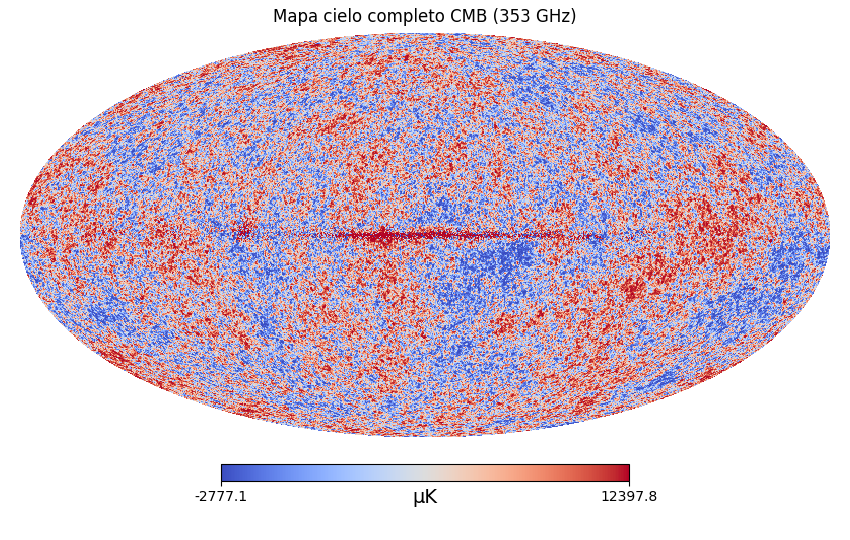
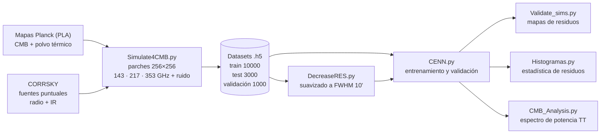
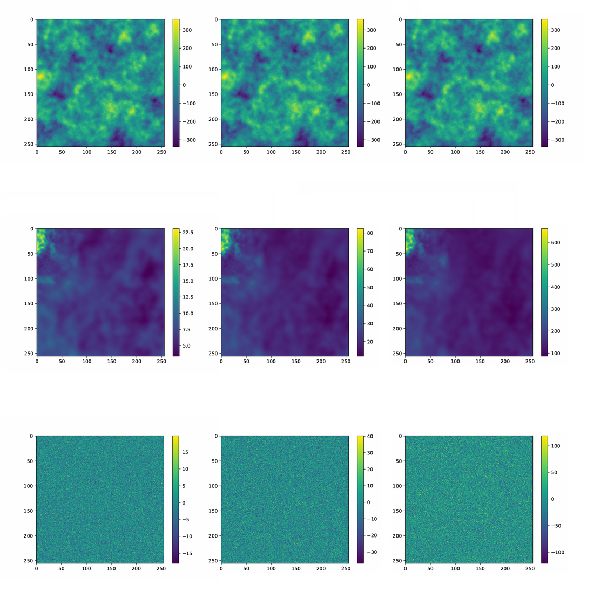
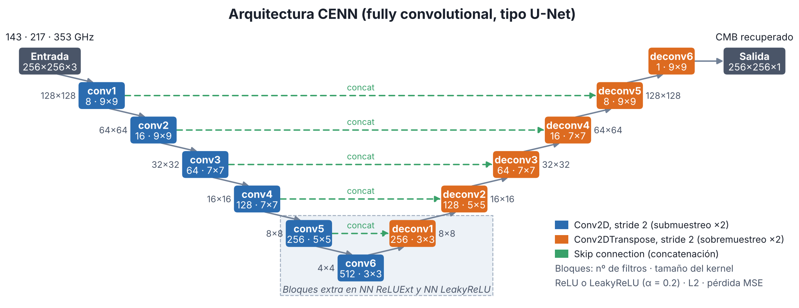
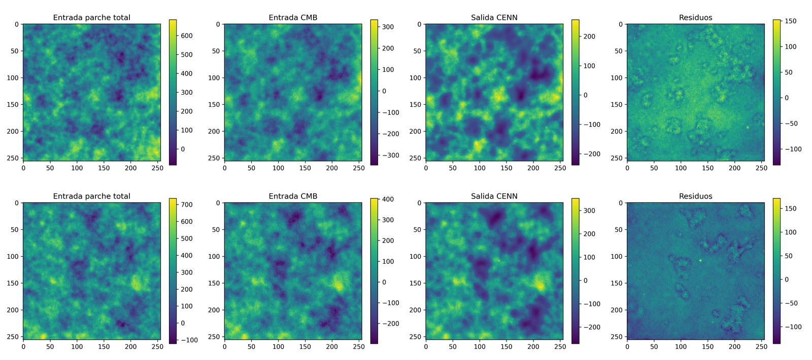
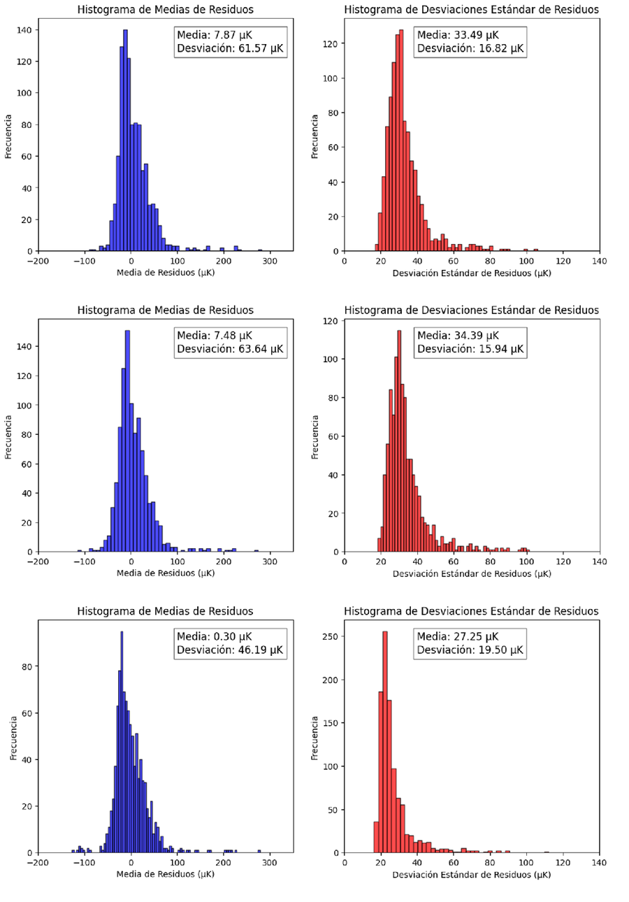
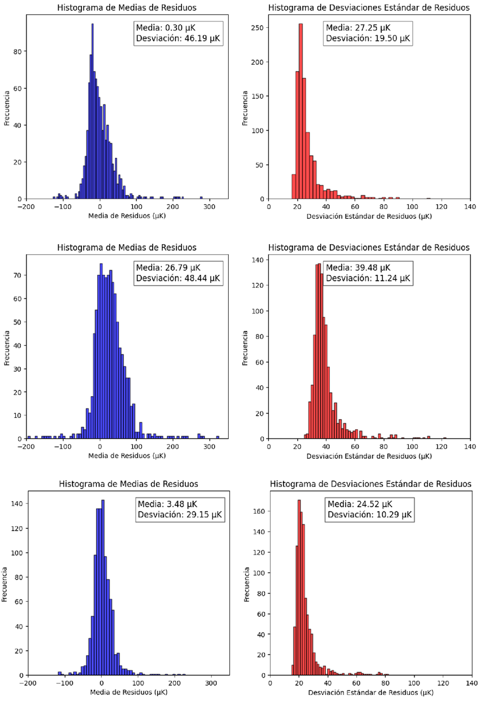
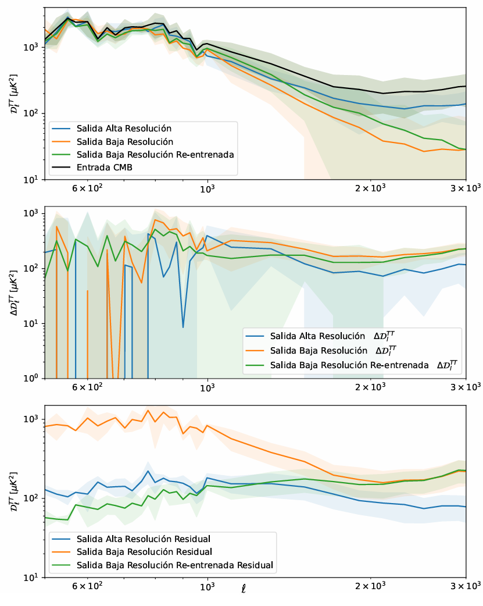

# Aplicación de redes neuronales a imágenes del CMB para incrementar su resolución


**Trabajo Fin de Grado · Grado en Física · Universidad de Oviedo · Curso 2024-2025**

**Autor:** Pablo Claudio Baragaño  
**Tutores:** Joaquín González-Nuevo González y Laura Bonavera

<p align="center">
  
</p>

En este TFG estudio cómo se comporta una **red neuronal completamente convolucional (CENN, tipo U-Net)** al recuperar el **Fondo Cósmico de Microondas (CMB)** a partir de simulaciones realistas del cielo de microondas de Planck, y cómo cambia su rendimiento cuando se **altera la resolución** de los datos de entrenamiento, test y validación.

📄 **[Memoria completa (PDF)](docs/TFG_memoria.pdf)** · 🎤 **[Presentación de la defensa (PDF)](docs/TFG_defensa.pdf)**

---

## English summary

Bachelor's thesis in Physics (University of Oviedo, 2025). I generated realistic 256×256-pixel simulations of the microwave sky at three Planck HFI frequencies (143, 217 and 353 GHz), including the CMB, Galactic thermal dust, extragalactic point sources and instrumental noise. I then trained a fully convolutional U-Net-style network (CENN) to recover the CMB signal and evaluated it through residual maps, residual statistics and the angular power spectrum.

I compared three network configurations (ReLU, a deeper ReLU network and a LeakyReLU network). The LeakyReLU network gave the best results, with a combined residual uncertainty of **53.6 µK** against about 70 µK for the ReLU variants. I also tested how robust the network is to resolution changes (Gaussian smoothing to a 10′ beam). A high-resolution model applied to low-resolution inputs performs poorly. A model retrained at low resolution has the lowest combined uncertainty (**38.1 µK**) and lower residuals at ℓ < 1000, but it underestimates the spectrum by an almost constant offset. **Main takeaway:** the network works best when training and application data share the same resolution, and a simple network cannot do super-resolution on its own.

**Stack:** Python · TensorFlow/Keras · NumPy · SciPy · h5py · healpy · Astropy · Matplotlib

---

## Contenido

- [Motivación y objetivos](#motivación-y-objetivos)
- [Flujo de trabajo](#flujo-de-trabajo)
- [Simulaciones](#simulaciones)
- [Arquitectura de la red](#arquitectura-de-la-red)
- [Experimentos](#experimentos)
- [Resultados](#resultados)
- [Conclusiones](#conclusiones)
- [Estructura del repositorio](#estructura-del-repositorio)
- [Instalación](#instalación)
- [Cómo reproducir el trabajo](#cómo-reproducir-el-trabajo)
- [Referencias](#referencias)
- [Autoría y agradecimientos](#autoría-y-agradecimientos)

---

## Motivación y objetivos

El CMB es la radiación más antigua que podemos observar del universo: se emitió en la Recombinación, unos 380.000 años después del Big Bang. Su estudio ha permitido confirmar el modelo ΛCDM y estimar los parámetros cosmológicos con gran precisión. Aun así, la resolución de los mapas está limitada por los instrumentos y por los **contaminantes galácticos y extragalácticos**, sobre todo a **multipolos altos (escalas pequeñas)**.

Las redes neuronales convolucionales se usan habitualmente para limpiar y mejorar imágenes. El objetivo del trabajo **no es optimizar una red para obtener la mejor recuperación posible**, sino **analizar críticamente su comportamiento**:

- Comparar distintas configuraciones de la red (número de capas y función de activación) mediante mapas de residuos, histogramas y espectros de potencia.
- Estudiar cómo varía el rendimiento al cambiar la resolución de los conjuntos de entrenamiento, test y validación.
- Valorar el impacto de estos resultados en el diseño de arquitecturas más robustas.

## Flujo de trabajo



## Simulaciones

Las simulaciones (`src/simulation/Simulate4CMB.py`) generan **parches 2D de 256×256 píxeles** (90″/píxel, unos 6,4° × 6,4°) en posiciones aleatorias del cielo, fuera de un corte galáctico de ±30° y con rotaciones aleatorias para que no haya dos parches iguales. Cada parche se simula en tres canales de **Planck HFI**:

| Canal | Frecuencia | FWHM | Sensibilidad (µK<sub>CMB</sub>·deg) |
|:--|:--:|:--:|:--:|
| Bajo | 143 GHz | 433,2″ | 0,55 |
| Central | 217 GHz | 294,0″ (~5′) | 0,78 |
| Alto | 353 GHz | 295,2″ | 2,56 |

**Componentes incluidas:**
- **CMB** y **polvo térmico galáctico**: mapas del *Planck Legacy Archive*, recortados con proyección gnomónica de HEALPix.
- **Fuentes puntuales extragalácticas** (fondo de radio, fondo infrarrojo y galaxias infrarrojas de tipo tardío), simuladas con **CORRSKY** (González-Nuevo et al. 2005). Las cuentas de fuentes siguen los modelos de Tucci et al. (2011) y el agrupamiento sigue Lapi et al. (2011); los archivos están en `src/simulation/counts/`.
- **Ruido instrumental** blanco con la sensibilidad de cada canal.

El sincrotrón y el efecto Sunyaev-Zeldovich son despreciables a estas frecuencias, así que no se incluyen. Para cada parche se guarda también el **CMB "verdadero"**, que es la etiqueta con la que se entrena la red.

<p align="center">
  
  <br><em>CMB, polvo térmico y ruido instrumental (filas) a 143, 217 y 353 GHz (columnas), en µK<sub>CMB</sub>.</em>
</p>

## Arquitectura de la red

La red (`src/model/CENN.py`) parte de **CENN** (*Cosmic microwave background Extraction Neural Network*, Casas et al. 2022). Es una red **completamente convolucional** de tipo **U-Net**:

- **Entrada:** 3 parches de 256×256 (uno por frecuencia, en la misma posición del cielo), normalizados a [0, 1] por parche y por canal.
- **Codificador:** 6 bloques `Conv2D` con *stride* 2 (8 → 512 filtros, núcleos de 9×9 a 3×3).
- **Decodificador:** 6 bloques `Conv2DTranspose` con *stride* 2 (256 → 1 filtro).
- **Skip connections:** se concatenan los mapas de cada bloque convolucional con su bloque de deconvolución, para recuperar detalle de pequeña escala.
- **Salida:** un parche de 256×256 con el CMB recuperado, que después se desnormaliza.
- **Entrenamiento:** pérdida MSE, optimizador Adagrad y regularización L2.

<p align="center">
  
</p>

## Experimentos

**1. Configuraciones de la red**

| Configuración | Capas conv + deconv | Activación |
|:--|:--:|:--:|
| NN ReLU | 4 + 4 | ReLU |
| NN ReLUExt | 6 + 6 | ReLU |
| NN LeakyReLU | 6 + 6 | LeakyReLU (α = 0,2) |

**2. Casos con resolución alterada** (con el mejor modelo, NN LeakyReLU). La baja resolución se consigue suavizando los parches totales con un filtro gaussiano hasta un **FWHM de 10′** (frente a ~5′ originales). La etiqueta (el CMB) se mantiene en alta resolución (`src/preprocessing/DecreaseRES.py`).

| Caso | Entrenamiento | Test | Validación |
|:--|:--:|:--:|:--:|
| Alta resolución (NN LeakyReLU) | Alta | Alta | Alta |
| Alta resolución validada a baja resolución | Alta | Alta | **Baja** |
| Re-entrenada a baja resolución | **Baja** | **Baja** | **Baja** |

## Resultados

### Mapas de residuos

<p align="center">
  
  <br><em>NN LeakyReLU sobre dos simulaciones de validación: parche total (217 GHz), CMB de entrada, salida de la red y residuos (µK).</em>
</p>

### Estadística de los residuos (1000 simulaciones de validación)

Para cada simulación se calcula la media y la desviación estándar del mapa de residuos. La incertidumbre global combinada es

$$\sigma_{\text{total}} = \sqrt{\mathrm{std}(\text{medias})^2 + \mathrm{mean}(\text{desviaciones})^2}$$

| Modelo | Media de las medias (µK) | Dispersión de las medias (µK) | Media de las desviaciones (µK) | **σ<sub>total</sub> (µK)** |
|:--|:--:|:--:|:--:|:--:|
| NN ReLU | 7,87 | 61,57 | 33,49 | 70,09 |
| NN ReLUExt | 7,48 | 63,64 | 34,39 | 72,33 |
| **NN LeakyReLU** | **0,30** | 46,19 | 27,25 | 53,62 |
| Alta res. validada a baja res. | 26,79 | 48,44 | 39,48 | 62,49 |
| **Re-entrenada a baja res.** | 3,48 | **29,15** | **24,52** | **38,09** |

<details>
<summary><b>Ver histogramas</b></summary>
<br>
<p align="center">
  
  &nbsp;
  
  <br><em>Izquierda: NN ReLU, NN ReLUExt y NN LeakyReLU. Derecha: alta resolución, validación a baja resolución y red re-entrenada a baja resolución.</em>
</p>
</details>

### Espectro de potencia angular (TT)

<p align="center">
  
  <br><em>Arriba: espectro del CMB de entrada y de las salidas. Centro: diferencia ΔD<sub>ℓ</sub>. Abajo: espectro de los residuos.</em>
</p>

- **LeakyReLU supera a ReLU** en todas las métricas: residuos mejor centrados (0,30 µK) y menor σ<sub>total</sub>. LeakyReLU evita el problema de las "neuronas muertas" de ReLU.
- Los tres casos de resolución dan espectros **compatibles hasta ℓ ≈ 600–700**.
- El modelo de **alta resolución aplicado a entradas de baja resolución** es el peor caso, con residuos muy altos a multipolos bajos.
- La red **re-entrenada a baja resolución** tiene residuos *menores* que la de alta resolución para ℓ < 1000. A cambio, **subestima** el espectro con un sesgo casi constante de ~200 µK² y empeora para ℓ > 1000, porque nunca vio datos de alta resolución.
- Para ℓ > 1000 todos los modelos subestiman la señal. El de alta resolución es el que mejor la recupera.

## Conclusiones

- Las redes neuronales **son capaces de recuperar el CMB** bajo múltiples configuraciones.
- Disponer de **información de alta resolución durante todo el proceso** da resultados más robustos y estables.
- La red funciona mejor cuando **las resoluciones de entrenamiento, test y validación coinciden**.
- Conseguir **super-resolución con una red sencilla no parece factible**. Aun así, entrenar con datos de resolución ligeramente menor podría mejorar los resultados si se corrige el sesgo.

**Trabajo futuro:** diseñar arquitecturas específicas para resoluciones mixtas, reducir el sesgo de las redes entrenadas a baja resolución, y aplicar el método a señales más intensas a multipolos altos, como el polvo galáctico. Ahí el problema pasa a ser solo de super-resolución, y se podría mejorar la resolución de los datos de Planck sin lanzar un nuevo satélite.

## Estructura del repositorio

```
CosmicMicrowaveBackground_TFG/
├── README.md
├── requirements.txt
├── CITATION.cff
├── docs/
│   ├── TFG_memoria.pdf           # Memoria completa del TFG
│   └── TFG_defensa.pdf           # Presentación de la defensa
├── figures/                      # Figuras usadas en este README
├── data/
│   └── README.md                 # Formato y ubicación de los datos (.h5 no incluidos)
└── src/
    ├── simulation/
    │   ├── Simulate4CMB.py       # Simulación de parches (CMB + foregrounds + ruido)
    │   ├── sim_cfreq217.par      # Parámetros de simulación (ejemplo)
    │   └── counts/               # Modelos de cuentas de fuentes (Tucci 2011, Lapi 2011, late-type)
    ├── preprocessing/
    │   └── DecreaseRES.py        # Degradación de resolución con filtro gaussiano
    ├── model/
    │   ├── CENN.py               # Arquitectura, entrenamiento y validación de la red
    │   ├── Parfile_CENN.par      # Hiperparámetros
    │   └── Parfile_I.par         # Rutas de los datasets y tamaño de parche
    └── analysis/
        ├── Validate_sims.py      # Mapas: entrada, CMB, salida y residuos
        ├── Histogramas.py        # Histogramas de medias y desviaciones de residuos
        └── CMB_Analysis.py       # Espectro de potencia angular TT
```

## Instalación

```bash
git clone https://github.com/pablcb/CosmicMicrowaveBackground_TFG.git
cd CosmicMicrowaveBackground_TFG
python -m venv .venv
source .venv/bin/activate        # En Windows: .venv\Scripts\activate
pip install -r requirements.txt
```

> **Notas**
> - `healpy` no tiene soporte nativo en Windows. Para las simulaciones usa Linux, macOS, WSL o Google Colab, que es donde se ejecutaron en el TFG.
> - Para entrenar la red es muy recomendable tener una GPU.
> - **Dependencias externas no incluidas:** el módulo `corrsky_v0124.py` (simulador de fuentes puntuales CORRSKY), que debe colocarse en `src/simulation/`, y los mapas FITS de CMB y polvo del [Planck Legacy Archive](https://pla.esac.esa.int/), cuyas rutas se indican en `sim_cfreq217.par`.
> - Los datasets `.h5` (miles de parches) **no se incluyen** por su tamaño. En [`data/README.md`](data/README.md) se describe su formato y dónde colocarlos.

## Cómo reproducir el trabajo

Cada script se ejecuta **desde su propia carpeta**. Las rutas son relativas a ella y apuntan a `data/`.

**1. Simular los datasets** (`src/simulation/`)
```bash
cd src/simulation
# Ajusta sim_cfreq217.par (rutas a los mapas del PLA, n_sims...) y en main()
# descomenta make_parallel_simu4CMB. Ejecuta una vez por conjunto:
#   train: n_sims = 10000 -> ../../data/output_sims_train
#   test:  n_sims = 3000  -> ../../data/output_sims_test
#   validate: n_sims = 1000 -> ../../data/output_sims_validate
python Simulate4CMB.py
```

**2. (Opcional) Degradar la resolución** (`src/preprocessing/`)
```bash
cd src/preprocessing
# Cambia INPUT_FILE / OUTPUT_FILE para cada conjunto
python DecreaseRES.py
```

**3. Entrenar y validar la red** (`src/model/`)
```bash
cd src/model
# Parfile_I.par: rutas a train/test/validación. Parfile_CENN.par: hiperparámetros.
# En main(): CENN_train(...) para entrenar, CENN_TestValidation(...) para validar.
python CENN.py
```
Esto genera, dentro de `src/model/Models_I/`, el mejor modelo (`*_Red_I.h5`), la curva de pérdidas y las predicciones sobre la validación (`*_Outputs_CENN_I.h5`). Las tres configuraciones se seleccionan como se explica en la cabecera de `CENN.py` (función de activación y entrada de `deconv3`).

**4. Analizar los resultados** (`src/analysis/`)
```bash
cd src/analysis
python Validate_sims.py   # mapas de residuos
python Histogramas.py     # histogramas y estadística de residuos
python CMB_Analysis.py    # espectro de potencia
```

Los valores de `Parfile_CENN.par` son los hiperparámetros por defecto de CENN, tal y como aparecen en el propio código. Los parámetros de simulación son los descritos en el capítulo 2 de la memoria.

## Referencias

- J. M. Casas et al. (2022). *CENN: A fully convolutional neural network for CMB recovery in realistic microwave sky simulations*. A&A 666, A89. [doi:10.1051/0004-6361/202243450](https://doi.org/10.1051/0004-6361/202243450)
- O. Ronneberger, P. Fischer y T. Brox (2015). *U-Net: Convolutional Networks for Biomedical Image Segmentation*. MICCAI.
- J. González-Nuevo, L. Toffolatti y F. Argüeso (2005). *Predictions of the angular power spectrum of clustered extragalactic point sources at CMB frequencies from flat and all-sky two-dimensional simulations*. ApJ 621, 1.
- M. Tucci et al. (2011). *High-frequency predictions for number counts and spectral properties of extragalactic radio sources*. A&A 533, A57.
- A. Lapi et al. (2011). *Herschel-ATLAS galaxy counts and high-redshift luminosity functions*. ApJ 742, 24.
- Planck Collaboration (2020). *Planck 2018 results. I. Overview and the cosmological legacy of Planck*. A&A 641, A1.

La bibliografía completa (64 referencias) está en la [memoria](docs/TFG_memoria.pdf).

## Autoría y agradecimientos

**Pablo Claudio Baragaño** · [GitHub](https://github.com/pablcb)

Trabajo realizado bajo la tutela de **Joaquín González-Nuevo González** y **Laura Bonavera** (Universidad de Oviedo). El código base de la red CENN es de J. M. Casas et al. (2022) y se ha adaptado para este trabajo. Si reutilizas el código, cita tanto este TFG (ver [`CITATION.cff`](CITATION.cff)) como el artículo de CENN.
